# GMK - PF2e: Golarion

Maps of the World of Golarion from the Pathfinder TTRPG with FoundryVTT Integration.

# Module Content

This section details content included in this module.

## [PF1e: Blank] [Map] - Inner Sea Region + Darklands

A hexploration map of the **Inner Sea Region** of **Golarion**; including three layers of the **Darklands**.

| FoundryVTT Level | Description | Features|
| --- | --- | --- |
| [Golarion - Inner Sea Region - Surface](assets/scenes/inner-sea-region/base.webp) | Surface-layer of Golarion | Notes, Regions|
| [Darklands - Inner Sea Region - Nar Voth](assets/scenes/darklands/nar-voth.webp) | Top-layer of the Darklands | TBA |
| [Darklands - Inner Sea Region - Sekamina](assets/scenes/darklands/sekamina.webp) | Middle-layer of the Darklands | TBA |
| [Darklands - Inner Sea Region - Orv](assets/scenes/darklands/orv.webp) | Bottom-layer of the Darklands | TBA |

### FoundryVTT Integration(s)

This section details FoundryVTT integrations for this module.

| Integration | Description |
| --- | --- |
| Notes | Map Pins linked to Blank Journal Entries. |
| Regions | Regions; without defined Behaviors. |

### Map Key

| Icon | Settlement |
| --- | :--- |
| 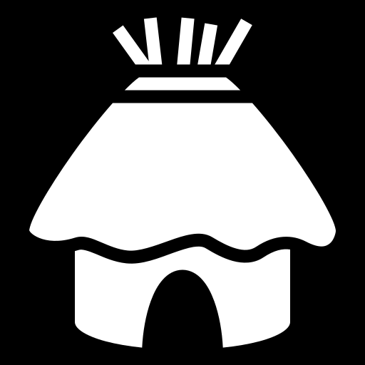 | thorp |
| 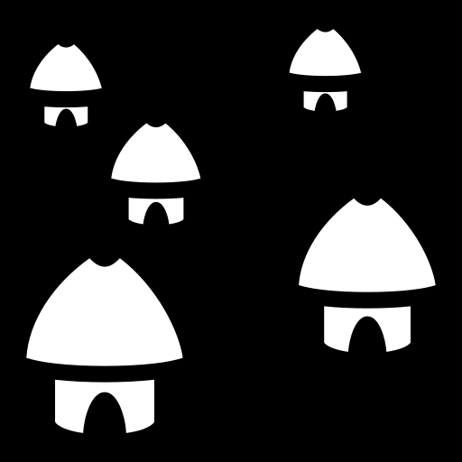 | hamlet |
| 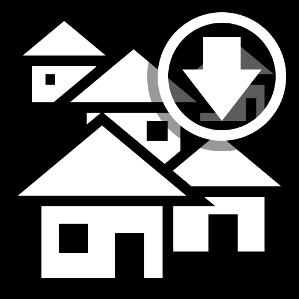 | small village |
| 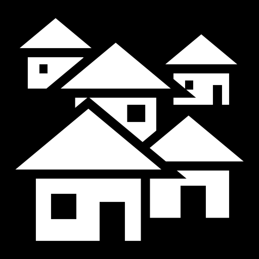 | village |
| 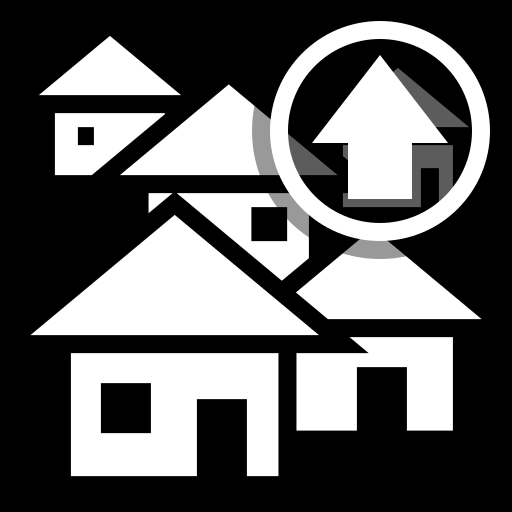 | large village |
| 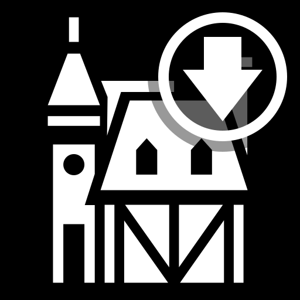 | small town |
| 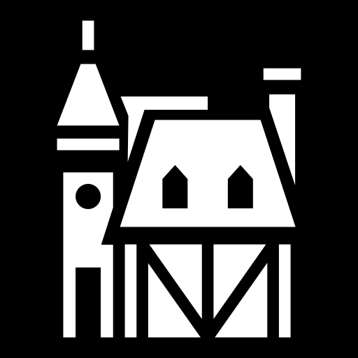 | town |
| 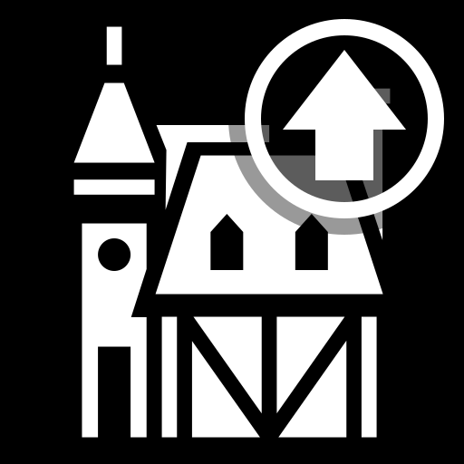 | large town |
| 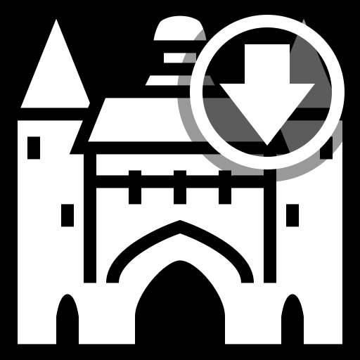 | small city |
| 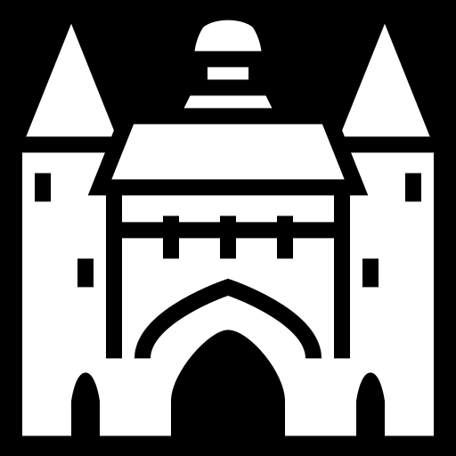 | city |
| 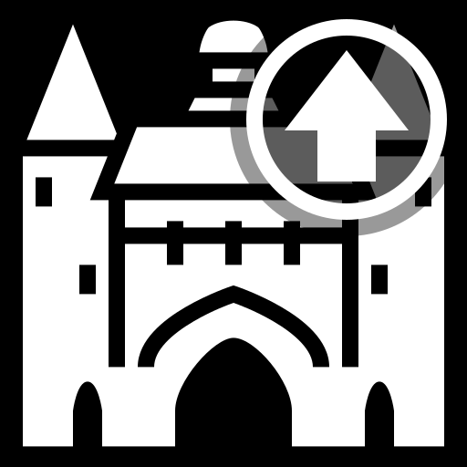 | large city |
|  | metropolis |
|  | capital |

### Additional Notes

This section details useful information.

> **Blank Variant:** means this map contains blank foundryvtt integrations (notes, journal entries, regions etc.) -- the intent is to allow GMs that prefer to create and manage their own content to benefit from this module, without the need to "scrub" the content from a "feature-complete" map first.

> **PF1e:** means this map is correct and accurate as of the start of PF1e: Age of Lost Omens. This is in reference to the names of locations and geography. (for example; Sargava in PF2e became Viridian).

### [Macro] - Scale Map

This macro will attempt to resize the currently active scene, and all placeables (map pins, regions, etc.) on that scene, to a specific grid size defined by the user. It will then output a copy of that scene, scaled to the input grid size.

### [Macro] - Scale Icons

This macro will resize all icons on the currently active scene to the input size.

# Active Development

This section details current development.

PF2e Map Variant: including updated Map Pins, Regions, Journal Entries, for Golarion's Inner Sea Region at the start of PF2e timeline.

# Licensing & Attribution

> **Paizo Inc. Community Use Policy**
> 
> This FoundryVTT Module uses trademarks and/or copyrights owned by Paizo Inc., used under Paizo's Community Use Policy (paizo.com/licenses/communityuse). We are expressly prohibited from charging you to use or access this content. This FoundryVTT Module is not published, endorsed, or specifically approved by Paizo. For more information about Paizo Inc. and Paizo products, visit paizo.com.
